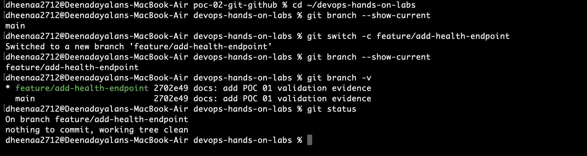
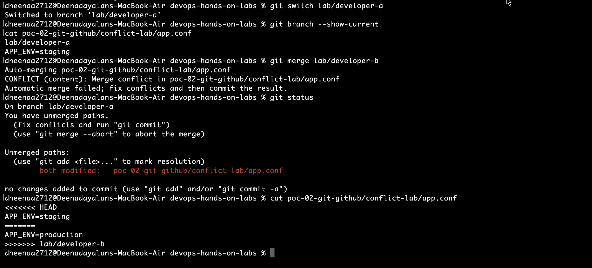
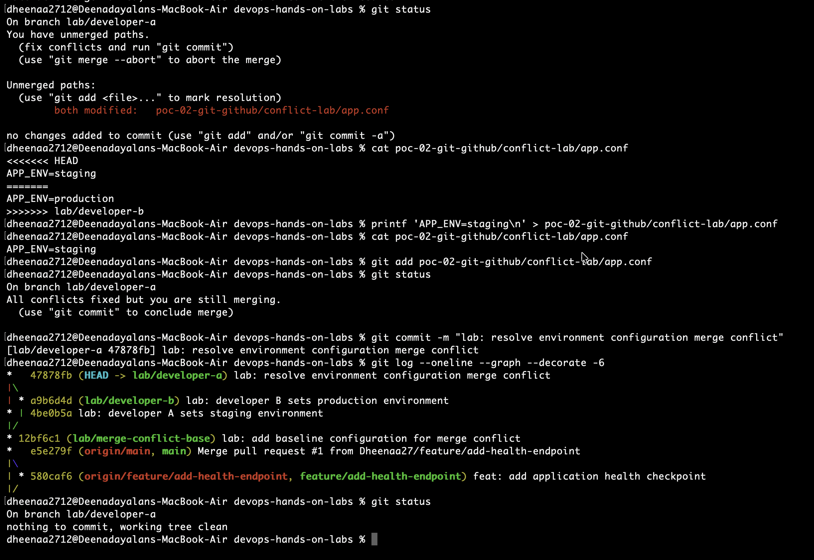
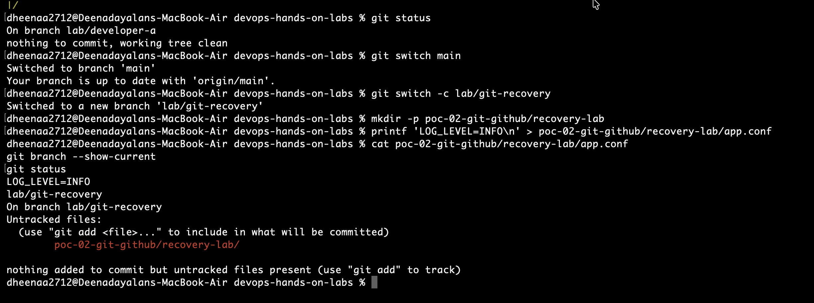
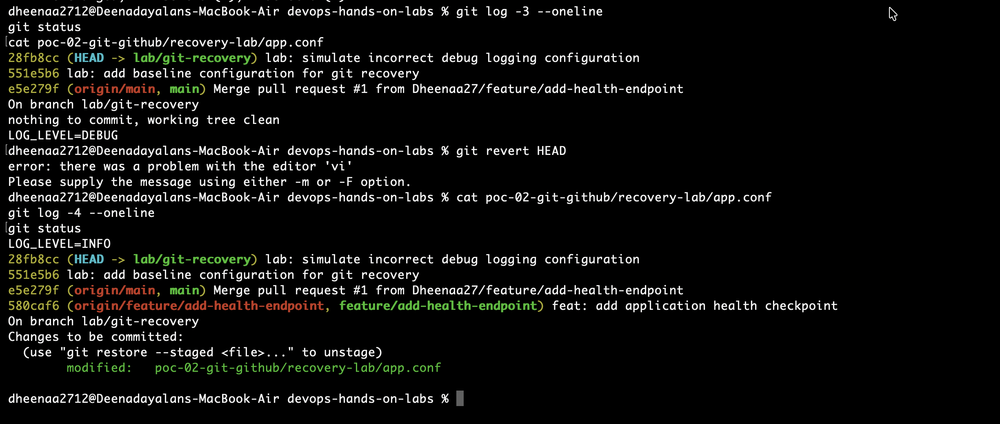

# POC 02 — Git & GitHub Workflows

## Objective

Demonstrate practical Git and GitHub workflows used in collaborative DevOps environments.

## Lab Environment

- Operating System: macOS
- Version Control: Git
- Remote Repository: GitHub
- Application: Python HTTP server
- Project: DevOps Hands-On Labs

## Exercises Completed

### 1. Feature Branch Workflow
- Created `feature/add-health-endpoint`
- Developed a Python HTTP application
- Committed changes on a feature branch
- Pushed the branch to GitHub

### 2. Pull Request Workflow
- Created GitHub Pull Request #1
- Reviewed application changes
- Added an inline code review comment
- Merged the pull request into `main`
- Synchronized the local repository

### 3. Merge Conflict Resolution
- Created a common baseline configuration
- Simulated Developer A and Developer B changes
- Triggered a Git merge conflict
- Inspected conflict markers
- Resolved the conflict
- Created a merge commit

### 4. Git Recovery
- Created a baseline configuration
- Simulated an incorrect configuration change
- Used Git revert to reverse the change
- Preserved the original commit history
- Verified the restored configuration

## Git Recovery Validation

Incorrect configuration:

`LOG_LEVEL=DEBUG`

Restored configuration:

`LOG_LEVEL=INFO`

Recovery commit: `280af71`

## Key Learning Outcomes

- Git branching and commit management
- GitHub pull requests and code reviews
- Merge conflict identification and resolution
- Safe recovery using Git revert
- Git history verification and troubleshooting

## Evidence

The following screenshots demonstrate the Git and GitHub workflows completed during this lab.

### Feature Branch Creation

### Pull Request and Code Review

### Merge Conflict Resolution

### Git Recovery

## Repository

https://github.com/Dheenaa27/DevOps_HandsOn_Labs

